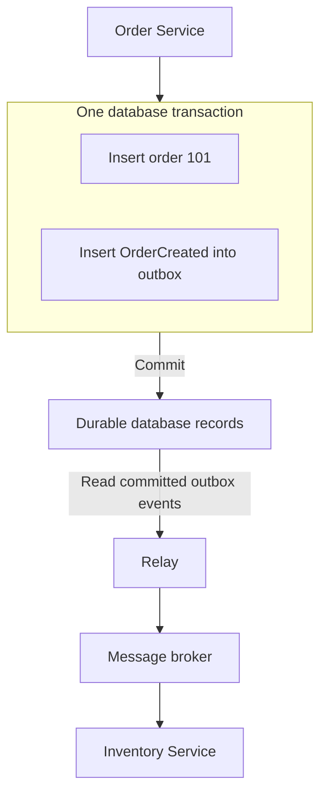

# Outbox — System Design Interview Notes

## 1. What Is It?

The **Transactional Outbox pattern** reliably connects a database change with an outgoing event.

Instead of saving business data and immediately sending a message, a service saves **business data and a message record in the same database transaction**. A separate worker later sends the stored message to a message broker, such as Kafka or RabbitMQ.

- **Transaction:** a group of database operations that all commit together or all roll back.
- **Event:** a message describing something that happened, such as `OrderCreated`.
- **Message broker:** infrastructure that accepts messages and delivers them to other services.
- **Outbox:** a durable table of messages waiting to be published.

Think of it as saving an order and its “notification to send” together. Sending happens afterward.

**Key distinction:** the atomic operation is saving the business change and the intention to publish. Database commit and broker publication still happen separately.

## 2. Why Do We Need It?

It solves the **dual-write problem**: one request needs to write to two independent systems, usually a database and a broker.

Imagine an Order Service that must save an order and publish `OrderCreated` so Inventory Service can reserve stock.

| Approach without Outbox | Failure | Result |
| --- | --- | --- |
| Save order, then publish | Service crashes after database commit | Order exists, but inventory never receives the event |
| Publish, then save order | Database transaction rolls back | Inventory reserves stock for an order that does not exist |

Changing the order of operations does not remove the failure window. An in-memory retry also disappears if the process crashes.

With Outbox, a committed order has a durable event record. If the broker is temporarily unavailable, a relay can retry later. This assumes the database remains durable and the relay eventually recovers; a permanently stopped relay cannot deliver messages.

## 3. How Does It Work?

### Example: Create order 101

1. Order Service starts a database transaction.
2. It inserts order `101` into `orders`.
3. It inserts event `evt-123`, type `OrderCreated`, into `outbox`.
4. It commits the transaction. Either both records exist or neither exists.
5. A **relay**, meaning a background publisher, finds the committed event.
6. It publishes the event to Kafka or RabbitMQ and waits for broker acknowledgment.
7. In a polling implementation, it marks the event as published after acknowledgment.
8. Inventory Service receives the event and reserves stock safely, including handling duplicate deliveries.

The diagram shows the transaction boundary. The relay and consumer operate outside that transaction.

### A simple polling outbox record

| Field | Example | Purpose |
| --- | --- | --- |
| `event_id` | `evt-123` | Stable unique ID for duplicate detection |
| `aggregate_id` | `101` | Business entity ID; here, the order ID |
| `event_type` | `OrderCreated` | Describes what happened |
| `payload` | `{"orderId":101,"quantity":2}` | Data the consumer needs |
| `created_at` | Creation timestamp | Monitoring and retention |
| `status` | `PENDING` | Tracks publishing progress |

An **aggregate** is a business entity or group of entities treated as one consistency unit. For this example, think “one order.” Fields vary by implementation; CDC implementations may not use a status column.

### What happens during failures?

| Failure point | Expected behavior |
| --- | --- |
| Before database commit | Both order and outbox insert roll back |
| After commit, before publish | Event remains available for the relay |
| Broker unavailable | Relay retries with increasing delays |
| After broker accepts, before relay records success | Relay may publish the same event again |
| Consumer commits its work, then crashes before acknowledgment | Broker may deliver the event again |

This normally gives **at-least-once delivery**: an event can arrive more than once. Outbox alone does not provide end-to-end exactly-once processing.

A consumer must be **idempotent**: processing the same event again must not repeat the business effect. For database effects, insert `event_id` into a processed-events table with a unique constraint and update inventory **in the same local transaction**. A duplicate ID means the work was already committed. Acknowledge the message after commit.

For an external effect, such as a payment API call, use an idempotency key supported by that API; a local processed-events table alone cannot atomically cover the external call.

### Two ways to build the relay

| Relay style | How it works | Main tradeoff |
| --- | --- | --- |
| Polling publisher | Periodically queries pending outbox rows | Easier to start; adds database queries and polling delay |
| CDC relay | Change Data Capture reads committed database changes from its log | Often lower latency; requires connector and log-management operations |

Debezium is a CDC tool with an Outbox Event Router that converts captured outbox records into outgoing events.

## 4. Real-World Use Case

An e-commerce application uses Spring Boot Order Service, PostgreSQL, Kafka, and Inventory and Notification services.

The order can be accepted while downstream services are temporarily unavailable. Stock reservation and email happen later. This is **eventual consistency**: services may briefly show different states before processing catches up. An accepted order can remain `PENDING` until inventory confirms reservation.

### Java / Spring Boot implementation outline

- A service method uses `@Transactional` to save the order and outbox event using the **same database transaction and transaction manager**.
- Build the event payload from the business operation and persist it before committing.
- A scheduled worker publishes pending rows, or Debezium captures committed outbox inserts.
- Consumers deduplicate using the stable event ID.

**Important:** placing a database write and `kafkaTemplate.send(...)` inside a method annotated with `@Transactional` does not, by itself, make the database and Kafka atomic. Kafka transactions alone also do not make an arbitrary database write atomic with a Kafka publish.

An after-commit callback avoids publishing before a rollback, but a crash between commit and the callback can still lose the notification unless it was durably recorded.

### Practical production concerns

- **Multiple relay instances:** coordinate ownership using locks or recoverable leases. An abandoned claim must become retryable.
- **Ordering:** if order events require sequence, preserve publication order per order and route the same order ID to the same Kafka partition. A partition key cannot fix events already published out of order. Timestamps alone are insufficient.
- **Retries:** use backoff, meaning increasing retry delays. Persist failures and alert on repeatedly failing events instead of silently dropping them.
- **Monitoring and cleanup:** track pending count, age of oldest pending event, and failure rate. Remove or archive safely published rows; coordinate CDC cleanup with capture progress.
- **Capacity:** a long broker outage grows the outbox. Plan storage and limits; availability is not unlimited.

## 5. Advantages and Disadvantages

| Advantages | Disadvantages / cost |
| --- | --- |
| Business change and event record commit together | Extra writes and outbox storage |
| Events survive application restarts | Relay, retries, cleanup, and monitoring need maintenance |
| Temporary broker outages need not block order creation | Consumers receive updates later |
| Avoids a distributed transaction across database and broker | Duplicate deliveries require idempotent consumers |
| Supports independent downstream services | Ordering needs deliberate coordination |

## 6. Alternatives and Comparison

| Approach | Difference from Outbox | When to choose it |
| --- | --- | --- |
| Direct database write + broker publish | Simple, but has a failure gap | Only when occasional missing notifications are acceptable or repair is explicitly designed |
| After-commit listener | Publishes only after commit, but may lose the event on a crash | Noncritical in-process notifications; not durable delivery by itself |
| Two-Phase Commit, or 2PC | Coordinates participating systems in one distributed transaction; adds coupling and can block during failures | Strict cross-resource atomicity is essential and all systems support it |
| CDC on business tables | Publishes raw data changes without an explicit event table; consumers may depend on database schema | Data replication or integrations naturally based on row changes |
| Event sourcing | Events are the source of truth; current state is derived from them | Event history and rebuilding state are core requirements; a separate broker still needs reliable publication |
| Saga | Coordinates a business workflow across services with local transactions and compensating actions | Order, payment, and inventory must form a multi-step workflow; use Outbox alongside it for reliable messages |

**CDC is not always an alternative:** CDC on the outbox table is one way to implement Outbox. An **Inbox** is also complementary: it durably records incoming messages or processed IDs on the consumer side.

**Choose Outbox when:** a committed business change must reliably produce an event, asynchronous delivery is acceptable, and you want to avoid a distributed database–broker transaction.

## 7. Interview Preparation

### A 1–2 minute interview answer

> The Transactional Outbox pattern solves the dual-write problem when a service must update its database and publish an event. For example, an Order Service saves an order and notifies Inventory Service. If it saves first and crashes before publishing, the notification is lost. If it publishes first and the database rolls back, consumers act on an order that does not exist.
>
> With Outbox, the service saves the order and an event record in the same local database transaction. Both commit or both roll back. A separate relay publishes committed events using polling or CDC, such as Debezium. If the broker is unavailable, the event remains durable and can be retried.
>
> Delivery is usually at least once. If the relay crashes after publishing but before recording success, it may publish again. Consumers therefore need idempotency, usually using a unique event ID and recording that ID in the same transaction as their database changes.
>
> In Spring Boot, I would put the business insert and outbox insert in one transactional service method. I would also design retry handling, ordering per business entity, monitoring, and cleanup. The tradeoff is reliable asynchronous communication in exchange for extra storage, operational work, and eventual consistency.

### Five important interview questions

**1. Why must the outbox record use the same transaction as business data?**

Otherwise, saving the business data could succeed while saving the event fails. That recreates the dual-write problem. Sharing a database is insufficient if the writes use separate transactions.

**2. Does Outbox guarantee exactly-once processing?**

No. A relay can publish successfully and crash before recording success. It then retries. Consumers must handle duplicates; broker guarantees alone do not cover every external business effect.

**3. How would you make Inventory Service idempotent?**

Give each event a stable ID. In one database transaction, insert that ID under a unique constraint and apply the inventory change. If the transaction fails, both roll back. On redelivery after a successful commit, the existing ID prevents a repeated stock change.

**4. How do you preserve ordering with multiple workers?**

Define the required scope, usually one order rather than the whole system. Use per-order sequencing and coordinate relay processing so later events do not overtake earlier ones. For Kafka, use order ID as the partition key and preserve consumer processing order as needed.

**5. Polling or CDC: which would you choose?**

Polling is a good starting point for moderate volume and simple operations. CDC is attractive when low latency and larger event volumes justify running connectors. Decide using throughput, latency targets, database support, and team experience.

### Common mistakes and tricky points

- Saying “Outbox makes all microservices one atomic transaction.” It only makes the local business change and event record atomic.
- Marking an event published before broker acknowledgment. This risks message loss.
- Generating a new event ID on every retry. Retries must keep the same ID for deduplication.
- Assuming `@Transactional`, Kafka transactions, or an after-commit listener automatically solve database–broker atomicity.
- Assuming Outbox guarantees ordering without configuring the relay and broker.
- Checking for a processed ID and applying the change in separate transactions. A crash or concurrent duplicate can still repeat the effect.

## 8. Quick Revision

1. **Problem:** database write and message publish can fail independently.
2. **Solution:** save business data and an outgoing event in one local transaction.
3. **Relay:** publish committed events using polling or CDC.
4. **Failures:** retry durable events; never mark success before broker acknowledgment.
5. **Duplicates:** expect at-least-once delivery and make consumers idempotent.
6. **Consistency:** downstream updates happen later; Outbox does not make all services atomic.
7. **Operations:** plan ordering, recoverable claims, retries, monitoring, and cleanup.

**Memory line:** Save together → publish later → retry safely → handle duplicates.

## References

- [Transactional Outbox pattern — Microservices.io](https://microservices.io/patterns/data/transactional-outbox.html)
- [Transactional Outbox — AWS Prescriptive Guidance](https://docs.aws.amazon.com/prescriptive-guidance/latest/cloud-design-patterns/transactional-outbox.html)
- [Outbox Event Router — Debezium documentation](https://debezium.io/documentation/reference/stable/transformations/outbox-event-router.html)
